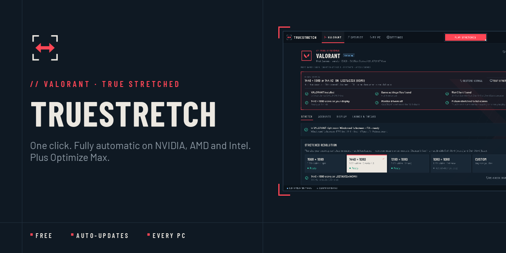
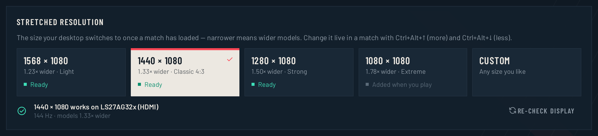
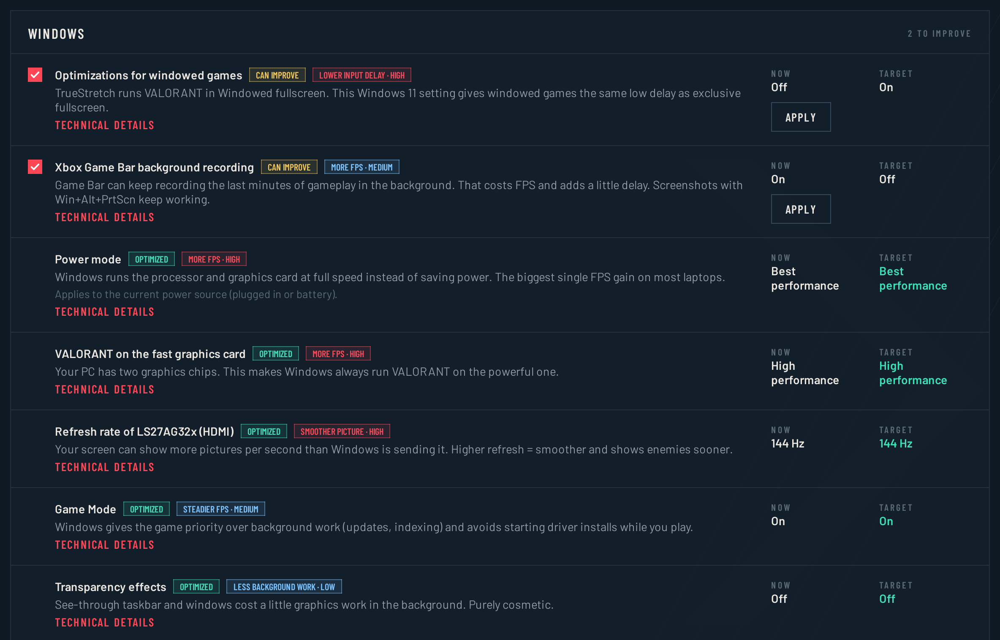
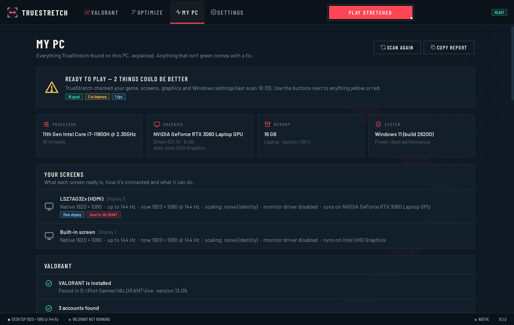
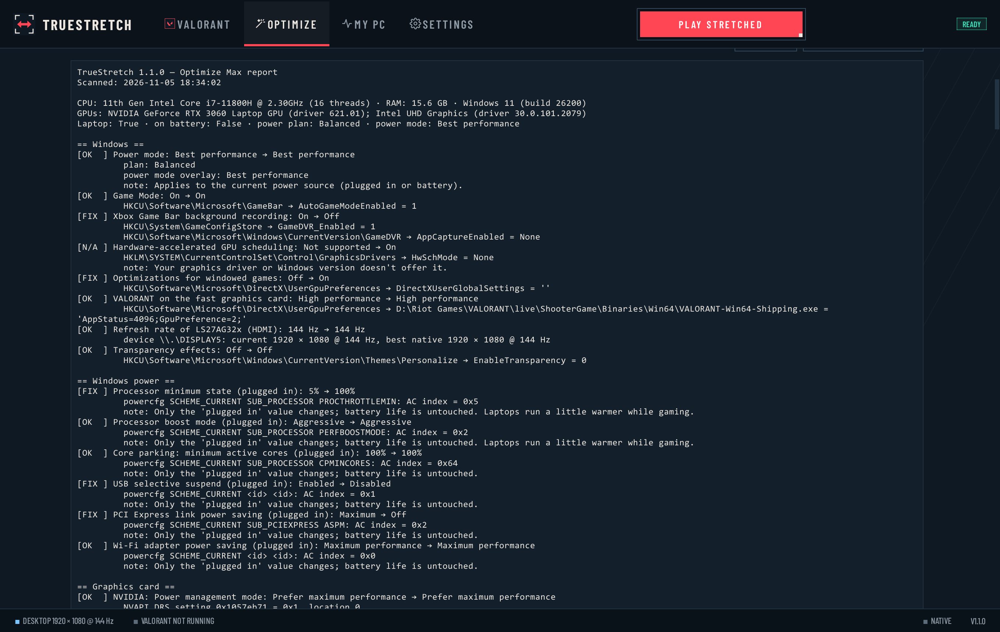
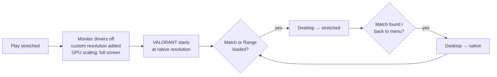

 

**[DOWNLOAD TRUESTRETCH.EXE](https://github.com/candyqueenjr/TrueStretch/releases/latest/download/TrueStretch.exe)** &nbsp;/&nbsp; [WEBSITE](https://candyqueenjr.github.io/TrueStretch/) &nbsp;/&nbsp; [CHANGELOG](CHANGELOG.md) &nbsp;/&nbsp; [REPORT A PROBLEM](https://github.com/candyqueenjr/TrueStretch/issues/new/choose)

---

TrueStretch gives you **true stretched resolution in VALORANT** — wider models, the classic 4:3 feel — without
touching a graphics-driver panel or a config file. Press **Play stretched** and it handles the rest, on any PC:
NVIDIA, AMD or Intel, desktop or laptop.

**Optimize Max** scans everything else on your PC that affects VALORANT's FPS and input delay and lists every change
on its own — what it is now, what it should be, and why. Nothing changes until you press Apply, and everything can be
undone.

## Features

| | |
|---|---|
| **One click** | *Play stretched* prepares everything and starts VALORANT. Menus stay normal; the stretch switches on as soon as a match or the Range has loaded. |
| **Fully automatic** | Adds the custom resolution to your graphics driver, sets full-screen scaling, turns the monitor drivers off and sets VALORANT to Windowed fullscreen + Fill. If a driver can't add a size, the closest one your screen already has is used. |
| **Four stretch levels** | Light, Classic 4:3, Strong, Extreme — or any size. Change it live in a match with <kbd>Ctrl</kbd>+<kbd>Alt</kbd>+<kbd>↑</kbd>/<kbd>↓</kbd>; <kbd>Ctrl</kbd>+<kbd>Alt</kbd>+<kbd>S</kbd> toggles. |
| **Optimize Max** | Windows (power mode, Game Mode, Game Bar recording, windowed-game optimizations, GPU scheduling, refresh rate, Sticky/Filter/Toggle Keys shortcut pop-ups, a switched-off page file, and proof of which graphics chip VALORANT really ran on), NVIDIA driver settings for VALORANT's profile only, VALORANT's graphics files for every account, the in-game settings (read from your account, with the value to pick), and your last match's real FPS with what limits it (graphics card, processor or FPS cap). Every change verified and undoable. |
| **Diagnostics** | A full technical report of every value read and every change made — copy it into a bug report in one click. |
| **Knows your PC** | *My PC* explains every screen, graphics card, driver and Windows setting in plain words, with a fix for anything that isn't right. |
| **Safe by design** | Backups before every change. A guard process puts your normal resolution back even if TrueStretch crashes. Never touches the game while it runs. |
| **Updates itself** | Checks GitHub for new versions, verifies the download (SHA-256) and updates in a few seconds. Your settings stay. |

## Get started

1. **[Download TrueStretch.exe](https://github.com/candyqueenjr/TrueStretch/releases/latest/download/TrueStretch.exe)** — one file, nothing to install.
2. Double-click it. Windows may show **"Windows protected your PC"** the first time → **More info → Run anyway**
   ([why?](#faq)).
3. The welcome tour scans your PC. Pick a stretch level.
4. Press **Play stretched**. Windows asks once for permission to turn the monitor drivers off — click **Yes**.
5. Load into the Range or a match.

> [!TIP]
> Keep TrueStretch running while you play (closing the window keeps it in the tray). It's what switches the stretch on
> in matches and back off in menus.

## Screenshots

<table>
<tr>
<td width="50%"> <b>STRETCH LEVELS</b> — pick how wide models get</td>
<td width="50%"> <b>OPTIMIZE MAX</b> — every change listed on its own</td>
</tr>
<tr>
<td width="50%"> <b>MY PC</b> — your setup, explained</td>
<td width="50%"> <b>DIAGNOSTICS</b> — full technical report</td>
</tr>
</table>

## How it works

VALORANT reads your screen's shape when it starts and when agent select loads. TrueStretch keeps the desktop at its
normal resolution at those moments and switches to the stretched size only after the map has loaded, reading the
game's own log to know exactly when.

## Requirements

- Windows 10 or 11 (64-bit)
- VALORANT installed
- Any NVIDIA, AMD or Intel graphics

## FAQ

<b>Why does Windows say "Windows protected your PC"?</b>

 
TrueStretch is free and not code-signed. Windows shows this for any new, unsigned program. Click <b>More info → Run
anyway</b>. You can check the file is genuine: each release lists its SHA-256 checksum — see <a href="SECURITY.md">SECURITY.md</a>.

<b>"Smart App Control blocked an app that may be unsafe" — what now?</b>

 
Smart App Control (Windows 11) blocks every program that isn't code-signed or widely known yet, and it has no
<i>Run anyway</i> button. TrueStretch is getting free code signing for open-source projects through
<a href="#code-signing-policy">SignPath Foundation</a>; signed releases pass Smart App Control. Until then, a PC with
Smart App Control turned on can't start TrueStretch. We don't recommend turning a Windows security feature off for
it — wait for the signed release (it updates itself on PCs where it already runs).

<b>Is it safe for my account?</b>

 
TrueStretch only changes your Windows display resolution, graphics-driver settings and VALORANT's own settings file —
the same things you could change by hand. It never reads or modifies game memory, never injects anything and never
interacts with Vanguard. Riot doesn't officially support true stretched resolution and we can't speak for Riot:
<b>use it at your own risk.</b>

<b>It's not stretched — what do I do?</b>

 
<ol>
<li>Make sure TrueStretch is running (tray icon) and you started VALORANT with <b>Play stretched</b>.</li>
<li>The stretch only switches on <i>after</i> the map has loaded — menus and agent select stay normal on purpose.</li>
<li>If VALORANT locked itself to the wrong size, TrueStretch tells you. Restart VALORANT with <b>Play stretched</b>.</li>
<li>Still stuck? <b>Settings → Support file</b> creates a zip on your Desktop — attach it to a
<a href="https://github.com/candyqueenjr/TrueStretch/issues/new?template=bug_report.yml">bug report</a>.</li>
</ol>

<b>Will Optimize Max change things without asking?</b>

 
No. It lists what it found; you choose what to apply. Each change is checked afterwards, and <b>Undo</b> puts back the
exact original value (including the copy HP OMEN AI keeps). It never touches security settings, and NVIDIA settings are
changed only in VALORANT's own program profile.

<b>Does it work on AMD / Intel / laptops?</b>

 
Yes. TrueStretch adds the resolution through the graphics driver (NVIDIA, AMD or Intel). If a driver refuses, it uses
the closest stretched resolution your screen already offers (for example 1400×1050 or 1280×1024).

<b>How do I undo everything?</b>

 
VALORANT page → <b>Restore normal</b> puts back your original settings files. <b>Optimize Max → Undo all</b> reverts
every optimization. <b>My PC → Monitor drivers → Turn back on</b> re-enables the monitor drivers.

<b>Does it collect any data?</b>

 
No. The only network request is an anonymous check for a newer version on GitHub (can be turned off in Settings).
See <a href="PRIVACY.md">PRIVACY.md</a>.

## Open source

TrueStretch is open source under the [GNU GPL v3](LICENSE). Every release is built from this repository's source by
[GitHub Actions](.github/workflows/release.yml), so anyone can check exactly what they download. To run it from
source or contribute, see [CONTRIBUTING.md](CONTRIBUTING.md). Third-party components: [THIRD-PARTY-NOTICES.md](THIRD-PARTY-NOTICES.md).

## Code signing policy

Free code signing provided by [SignPath.io](https://about.signpath.io), certificate by
[SignPath Foundation](https://signpath.org).

- Committers and reviewers: [candyqueenjr](https://github.com/candyqueenjr)
- Approvers: [candyqueenjr](https://github.com/candyqueenjr)

Only `TrueStretch.exe` built by this repository's [release workflow](.github/workflows/release.yml) from a tagged
version is signed, and an approver confirms every signing request by hand. Changes from anyone else are reviewed
before they are merged.

**Privacy:** this program will not transfer any information to other networked systems unless specifically
requested by the user or the person installing or operating it, apart from an anonymous check for new versions on
GitHub, which can be turned off. See [PRIVACY.md](PRIVACY.md).

## Support

- [Report a bug](https://github.com/candyqueenjr/TrueStretch/issues/new?template=bug_report.yml) — attach the support file from *Settings → Support file*
- [Suggest a feature](https://github.com/candyqueenjr/TrueStretch/issues/new?template=feature_request.yml)
- [Discussions](https://github.com/candyqueenjr/TrueStretch/discussions) — questions, tips, setups

---

TrueStretch is free, open-source software under the GNU GPL v3, provided as-is — see [LICENSE](LICENSE). The name
TrueStretch and its logo identify the official version; modified versions must use a different name. Fonts: Barlow
(SIL Open Font License).
TrueStretch isn't endorsed by Riot Games and doesn't reflect the views or opinions of Riot Games or anyone officially
involved in producing or managing Riot Games properties. Riot Games, VALORANT, and all associated properties are
trademarks or registered trademarks of Riot Games, Inc.
