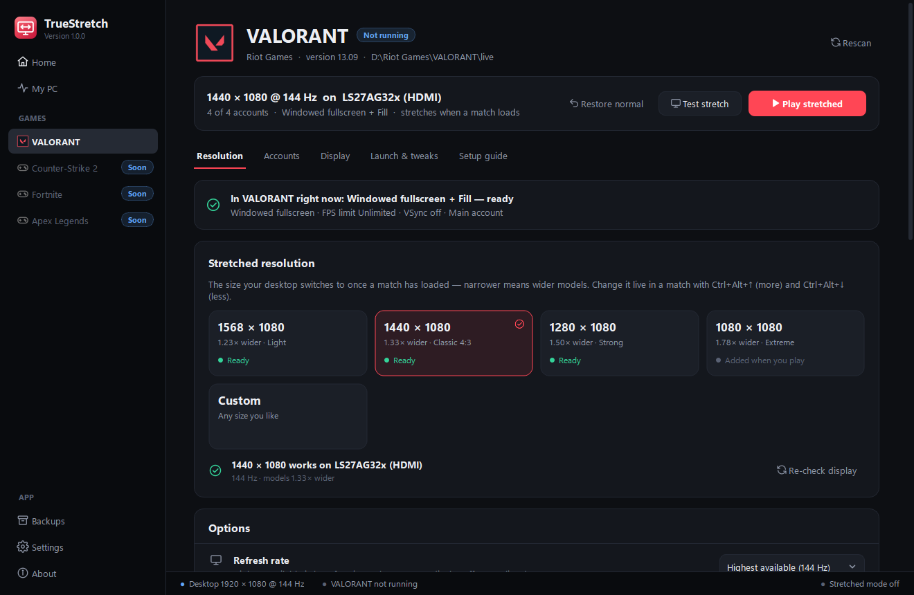
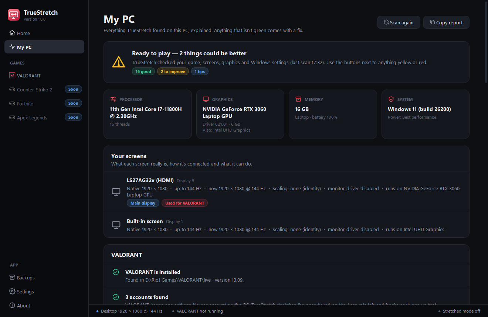
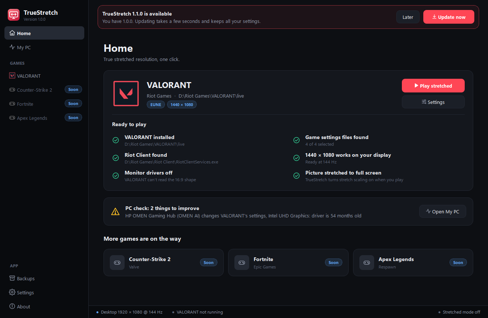
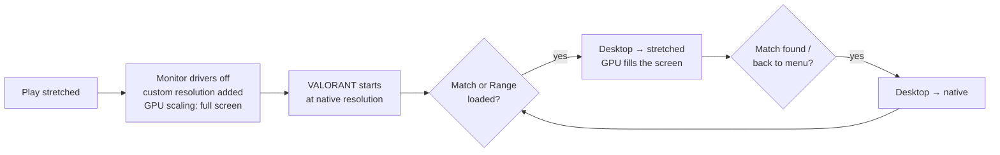

 

### **[⬇ Download TrueStretch.exe](https://github.com/candyqueenjr/TrueStretch/releases/latest/download/TrueStretch.exe)** &nbsp;·&nbsp; [Website](https://candyqueenjr.github.io/TrueStretch/) &nbsp;·&nbsp; [What's new](CHANGELOG.md) &nbsp;·&nbsp; [Report a problem](https://github.com/candyqueenjr/TrueStretch/issues/new/choose)

---

**TrueStretch** gives you *true* stretched resolution in VALORANT — wider player models, the classic 4:3 feel — without
touching a single graphics-driver panel or config file. Press **Play stretched**, and it handles the rest on every
PC: NVIDIA, AMD or Intel, desktop or laptop.

## ✨ Features

| | |
|---|---|
| 🎯 **One click** | *Play stretched* prepares everything and starts VALORANT. Menus stay sharp and normal; the stretch switches on the moment a match or the Range has loaded. |
| 🧠 **Fully automatic** | Adds the custom resolution to your graphics driver, sets full-screen scaling, turns the monitor drivers off and sets VALORANT to Windowed fullscreen + Fill. If your driver can't add a size, it picks the closest one your screen already has. |
| 🎚️ **Four stretch levels** | Light, Classic 4:3, Strong and Extreme — or any size you like. Change it live in a match with <kbd>Ctrl</kbd>+<kbd>Alt</kbd>+<kbd>↑</kbd>/<kbd>↓</kbd>; <kbd>Ctrl</kbd>+<kbd>Alt</kbd>+<kbd>S</kbd> toggles. |
| 🔍 **Knows your PC** | *My PC* explains every screen, graphics card, driver and Windows setting in plain words — with a one-click fix for anything that isn't right. |
| 🛡️ **Safe by design** | Backs up every file before changing it. A guard process puts your normal resolution back even if TrueStretch crashes. Never touches the game while it runs. |
| 🔄 **Auto-updates** | Checks GitHub for new versions, verifies the download (SHA-256) and updates itself in a few seconds. Your settings stay. |
| 👥 **Every account** | Sets up every Riot account on the PC — and new ones automatically after their first sign-in. |

## 🚀 Get started

1. **[Download TrueStretch.exe](https://github.com/candyqueenjr/TrueStretch/releases/latest/download/TrueStretch.exe)** — one file, nothing to install.
2. Double-click it. Windows may show **“Windows protected your PC”** the first time → click **More info → Run anyway**
   ([why?](#why-does-windows-say-windows-protected-your-pc)).
3. The welcome tour scans your PC. Pick a stretch level.
4. Press **Play stretched**. Windows asks once for permission to turn the monitor drivers off — click **Yes**.
5. Load into the Range or a match: you're stretched. 🎉

> [!TIP]
> Keep TrueStretch running while you play (closing the window keeps it in the tray). It's what switches the stretch on
> in matches and back off in menus.

## 🖼️ Screenshots

<table>
<tr>
<td width="50%"> <b>Stretch levels</b> — pick how wide models get</td>
<td width="50%"> <b>My PC</b> — everything about your setup, explained</td>
</tr>
<tr>
<td width="50%"> <b>Ready-to-play checklist</b></td>
<td width="50%"> <b>Auto-updates</b> — one click, verified</td>
</tr>
</table>

## ⚙️ How it works

VALORANT reads your screen's shape when it starts and when agent select loads. TrueStretch keeps the desktop at its
normal resolution at those moments and switches to the stretched size only after the map has loaded, reading the
game's own log to know exactly when. That's what makes the stretch *true* instead of black bars.

## 💻 Requirements

- Windows 10 or 11 (64-bit)
- VALORANT installed
- Any NVIDIA, AMD or Intel graphics

## ❓ FAQ

<b>Why does Windows say “Windows protected your PC”?</b>

 
TrueStretch is free and not code-signed (signing certificates cost money every year). Windows shows this for any new,
unsigned program. Click <b>More info → Run anyway</b>. You can check the file is genuine: each release lists its
SHA-256 checksum — see <a href="SECURITY.md">SECURITY.md</a>.

<b>Is it safe for my account?</b>

 
TrueStretch only changes your Windows display resolution, your graphics driver's scaling and VALORANT's own settings
file — the same things you could change by hand. It never reads or modifies game memory, never injects anything and
never interacts with Vanguard. That said, Riot doesn't officially support true stretched resolution and we can't speak
for Riot: <b>use it at your own risk.</b>

<b>It's not stretched — what do I do?</b>

 
<ol>
<li>Make sure TrueStretch is running (tray icon) and you started VALORANT with <b>Play stretched</b>.</li>
<li>The stretch only switches on <i>after</i> the map has loaded — menus and agent select stay normal on purpose.</li>
<li>If you switched resolution by hand while VALORANT was loading, it may have locked itself — TrueStretch tells you.
Restart VALORANT with <b>Play stretched</b>.</li>
<li>Still stuck? <b>Settings → Support file</b> creates a zip on your Desktop — attach it to a
<a href="https://github.com/candyqueenjr/TrueStretch/issues/new?template=bug_report.yml">bug report</a>.</li>
</ol>

<b>Does it work on AMD / Intel / laptops?</b>

 
Yes. TrueStretch adds the resolution through the graphics driver (NVIDIA, AMD or Intel). If a driver refuses, it
automatically uses the closest stretched resolution your screen already offers (for example 1400×1050 or 1280×1024).
Laptops with two graphics chips are handled too.

<b>How do I undo everything?</b>

 
VALORANT page → <b>Restore normal</b> puts back your original settings files. <b>My PC → Monitor drivers → Turn back
on</b> re-enables the monitor drivers. Your desktop resolution goes back to normal on its own whenever you leave a match.

<b>Does it collect any data?</b>

 
No. The only network request is an anonymous check for a newer version on GitHub (can be turned off in Settings).

## 🤝 Support

- 🐞 [Report a bug](https://github.com/candyqueenjr/TrueStretch/issues/new?template=bug_report.yml) — attach the support file from *Settings → Support file*
- 💡 [Suggest a feature](https://github.com/candyqueenjr/TrueStretch/issues/new?template=feature_request.yml)
- 💬 [Discussions](https://github.com/candyqueenjr/TrueStretch/discussions) — questions, tips, setups

---

TrueStretch is free software provided as-is — see [LICENSE](LICENSE). TrueStretch isn't endorsed by Riot Games and
doesn't reflect the views or opinions of Riot Games or anyone officially involved in producing or managing Riot Games
properties. Riot Games, VALORANT, and all associated properties are trademarks or registered trademarks of Riot Games,
Inc.
